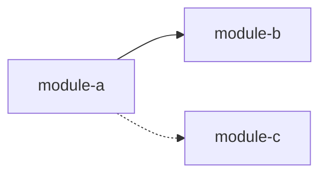

# Khung tài liệu

Dùng khi giao prompt tổng hợp và prompt nhóm module (dán nguyên khung vào prompt). Ngôn ngữ theo đầu vào; mặc định tiếng Việt có dấu.

## Khung README module

```markdown
# <tên module>

## Mục đích
<một đến hai câu; lấy từ README có sẵn hoặc tên và điểm vào; khẳng định về hành vi kèm `file:line`>

## Cấu trúc thư mục
<cây rút gọn, tối đa hai cấp; không mô tả nội dung file cấu hình>

## Điểm vào
- `<file:line>`: <vai trò>

## API hoặc route
| Đường dẫn | Phương thức | Handler | Bằng chứng |
|---|---|---|---|
| `/<đường-dẫn>` | GET | `<lớp>.<hàm>` | `<file:line>` |

Không thấy route trong code đã đọc: ghi đúng một dòng "Không thấy route trong phần đã đọc" và liệt kê phần chưa đọc ở cuối.

## Cấu hình
Chỉ tên khoá, không giá trị.

| Tên khoá | Bằng chứng | Ghi chú |
|---|---|---|
| `<tên-khoá>` | `<file:line>` | <dùng ở đâu, nếu thấy> |

Giá trị không ghi trong tài liệu này. Muốn biết giá trị, xem file cấu hình trong môi trường chạy.

## Phụ thuộc
| Module | Cách phụ thuộc | Bằng chứng |
|---|---|---|
| `<module-b>` | có lời gọi | `<file:line>` |
| `<module-c>` | chỉ khai báo | trường `declaredDeps` của kiểm kê |



Sơ đồ và bảng trên cùng nội dung. Nét liền: có lời gọi. Nét đứt: chỉ khai báo. Nhãn không chứa `<` hay `>`.

## Đã đọc / chưa đọc
- Đã đọc: <danh sách file hoặc thư mục>
- Chưa đọc: <danh sách, kèm lý do: ngân sách | file cấu hình | không nhận dạng>
- Khẳng định [Unverified]: <số>
```

## Khung README root

```markdown
# <tên project>

## Tổng quan
<một đoạn: project làm gì, ai dùng; lấy từ README có sẵn hoặc `[Unverified]`>

## Cách chạy
<chỉ lệnh có trong README có sẵn hoặc trong mục scripts của package.json, kèm `file:line`; áp luật lệnh ở mục E của subagent-prompts.md>

## Module
| Module | Đường dẫn | Loại | Nhiệm vụ | README |
|---|---|---|---|---|
| `<id>` | `<path>` | <maven/gradle/npm/python> | <một dòng> | [README](<path>/README.md) |

## Sơ đồ phụ thuộc
<Mermaid, cùng nội dung bảng dưới>

| Từ | Đến | Cách phụ thuộc |
|---|---|---|
| `<id>` | `<id>` | có lời gọi / chỉ khai báo |

## Thư mục chưa thuộc module nào
<danh sách `unclaimed` từ kiểm kê; file ở gốc: số `rootFiles`; ghi "không có" nếu rỗng>

## Tài liệu
- [Tổng quan](project-knowledge/project-overview.md), [Kiến trúc](project-knowledge/architecture.md), [Cấu trúc mã nguồn](project-knowledge/source-structure.md), [Stack](project-knowledge/tech-stack.yml)
- Chỉ liệt kê link tới file thực sự được ghi hoặc đã có sẵn và được giữ.

## Đã đọc / chưa đọc
<theo module; số `[Unverified]`>
```

## Bốn file project-knowledge

Nguồn: `<thư mục skill artifact-templates>/references/project-knowledge/`. Chỉ dùng bốn file: `project-overview.md`, `architecture.md`, `source-structure.md`, `tech-stack.yml`. Không dùng `code-convention.md` và `domain-context.md`.

Cách điền:
1. Chép nội dung template. Bỏ khối header: từ `<!-- artifact-template` ở dòng 1 tới `-->` (khối có dòng "Bỏ khối này khi chép template ra dùng" bên trong). `tech-stack.yml` không có khối này, giữ nguyên.
2. Thay `<...>` bằng nội dung có bằng chứng (`file:line`) hoặc `[Unverified] <mô tả>`. Không để `<...>` trong file đầu ra.
3. `source-structure.md`: template giả định `src/` và các quy ước mẫu. Chỉ giữ quy ước đã thấy trong code, kèm `file:line`; bỏ dòng trỏ tới `docs/decisions/0001-*.md` nếu không có file đó.
4. `architecture.md`, mục "Quyết định kiến trúc chính": trỏ tới `docs/decisions/` chỉ khi thư mục có thật.
5. `tech-stack.yml`: version chỉ ghi khi có `file:line` trong nguồn được phép: `package.json` (dependencies, devDependencies), `requirements.txt`, lock file (`package-lock.json`, `yarn.lock`, `poetry.lock`). Maven và Gradle không có nguồn được phép (không mở `pom.xml`, `build.gradle`), nên ghi `"[Unverified]"`. Không mở file cấu hình để lấy version.
6. Mermaid trong `architecture.md` luôn kèm bảng chữ cùng nội dung.

## Luật file có sẵn (README, project-knowledge)

Cổng 1 đã chọn một trong các lựa chọn. Không ghi đè file có sẵn trong mọi trường hợp.

- Giữ: không đụng file. Không đưa file đó vào `changes`.
- Khối marker: file phải có đúng một cặp marker:
  ```
  <!-- aip:onboarding begin -->
  ...nội dung do skill ghi...
  <!-- aip:onboarding end -->
  ```
  Chỉ thay phần giữa hai marker, giữ nguyên hai dòng marker. Chưa có cặp marker (không có begin lẫn end): thêm khối vào cuối file, không sửa phần trên. Chỉ có begin mà thiếu end, chỉ có end mà thiếu begin, hoặc có nhiều hơn một cặp: dừng, báo `blocked`, không ghi.
- Bỏ: không tạo file này trong lần chạy. File có sẵn không bị sửa hay xoá.
- `tech-stack.yml` chỉ có giữ hoặc bỏ. Không dùng marker vì nối khối vào YAML có sẵn gây trùng khoá cấp một.
